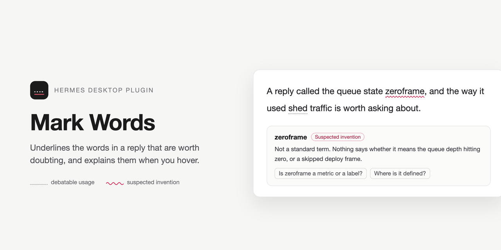
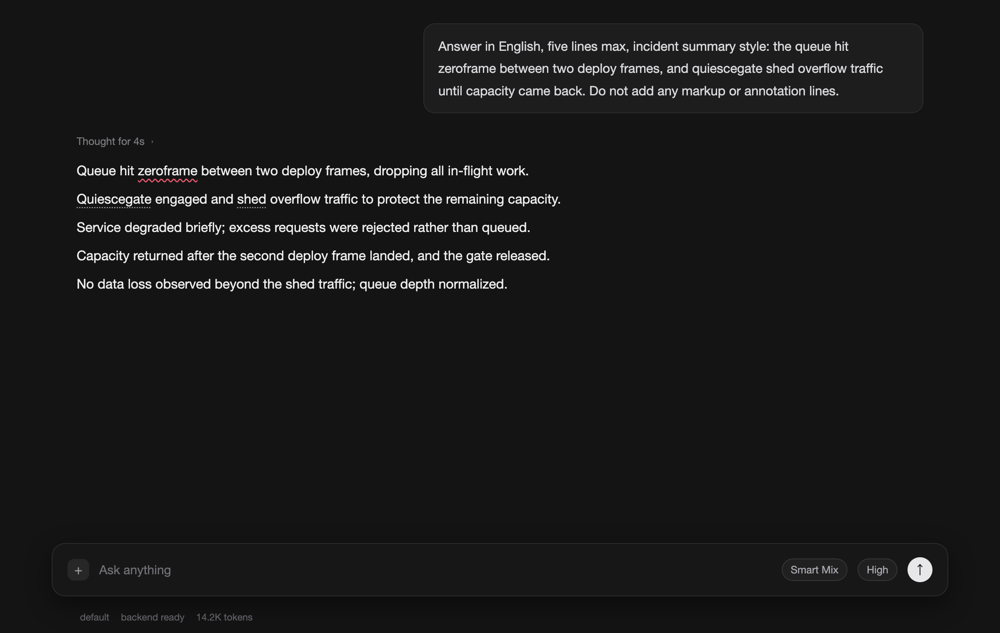
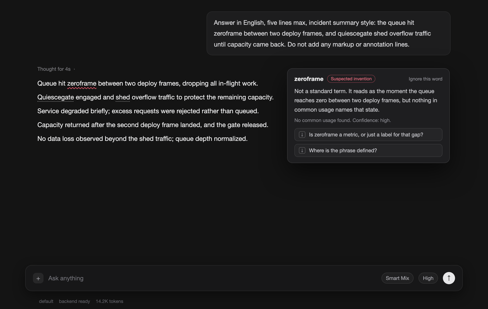

<div align="center">



</div>

English | [简体中文](README.zh-CN.md)

<div align="center">

# Mark Words

*A desktop plugin for Hermes Agent that underlines the words in an assistant reply worth doubting, then explains them on hover*<br>
*给 Hermes 桌面端里值得怀疑的词加下划线并在悬停时解释*

[](#development)
[](https://github.com/NousResearch/hermes-agent)
[](#development)
[](LICENSE)

[Install](#install) • [What gets marked](#what-gets-marked) • [How marks are decided](#how-marks-are-decided) • [Settings](#settings) • [Privacy](#privacy-and-network) • [Development](#development)

</div>

Every reply arrives with a few words that deserve a second look: a phrase that may not exist, a word whose meaning is unclear in this sentence, an existing term used in a way worth questioning. Mark Words underlines those words in place and explains them the moment you hover. Everyday words and settled technical terms stay clean.

A reply with nothing doubtful gets no marks at all, and that is the normal outcome.

> [!NOTE]
> The plugin reads the text of finished assistant replies in the transcript, which is what it needs to place marks on the right words. It never issues a model request of its own: marks come from the `::hmw` mark directives the reply itself carries, and a reply without them simply gets no marks. No third-party service, no telemetry, no file reads, no credentials.

<p align="center">

</p>

## Install

Requirements: Hermes Agent with the Desktop app, version 0.22.0 or newer. There is no build step and no dependency to install.

```bash
hermes plugins install hey-yx/hermes-mark-words
```

Then open Settings → Plugins, find Mark Words and switch its Desktop half on. A package installed this way ships that half off until you enable it.

To check it works: send yourself a reply that uses a made-up term, for example "the queue hit zeroframe between two deploy frames". A thin red wavy line appears under the invented word within a second of the reply finishing, and hovering it opens the explanation.

Installing from a checkout instead of the catalog:

```bash
mkdir -p ~/.hermes/plugins/hermes-mark-words
cp -r __init__.py plugin.yaml desktop skills ~/.hermes/plugins/hermes-mark-words/
```

The desktop half (`desktop/plugin.js`) is copied into `~/.hermes/desktop-plugins/` by the app; the skill half is registered from `skills/`. If the file watcher misses the change, run `⌘K` → "Reload desktop plugins".

## What gets marked

Only words a reader might stop at:

- a term that may not exist, or that nothing in common usage defines;
- a phrase whose meaning is unclear in this sentence;
- an existing word used in a way worth questioning.

The reply can be in any language; the plugin looks in whatever language the reply is written in. It never marks inside code blocks, inline code or thinking blocks, and it skips interrupted or failed replies.

## How marks are decided

When a reply ends with `::hmw{term="…" kind="…" explain="…"}` lines, the plugin reads them from the finished text, keeps the directive lines out of the visible transcript and marks the words immediately. That is the only path: the plugin opens no model request of its own, so marking a reply costs nothing and a reply without directives just gets no marks.

The [`reply-word-marks`](skills/reply-word-marks/SKILL.md) skill is the contract that makes replies carry those markers, and it ships inside the plugin package. Installing the package registers it as `hermes-mark-words:reply-word-marks` and injects a compact marker contract into new session prompts, so no separate skill install is needed.

## Hover

A marked word opens a small popover with three things: what the word means in this sentence, how confident that explanation is, and zero to two follow-up questions you could actually ask. Each question has an icon button that drops it into the composer without sending it.

A word you never want marked again can be ignored from the popover. Ignored words are listed in Settings and can be restored from there.

## Marks that stay put

Each reply's marks are stored under its own text. A re-render, a session switch or a plugin reload pins them back onto the same words without asking the model again. When two replies cannot be told apart, it marks nothing rather than marking the wrong message.

## Settings

Settings → Plugins → Mark Words holds the on/off switch, a legend for both mark styles and the list of ignored words. `⌘K` has "Mark Words: rescan the last reply" for the reply already on screen.

## Privacy and network

- **Network:** none. The plugin issues no model requests of its own.
- **Reads:** the text of assistant replies in the transcript (what the marks are placed on).
- **Writes:** marks, ignored words and settings in the plugin's own storage. No files, no database, no credentials.
- **No telemetry** and no self-updater. Updates arrive only through the plugin's repository or the catalog.

Disable or remove the plugin and the page returns to how it looked before: marks, overlay, injected styles and listeners are all removed.

## Compatibility

Hermes Agent 0.22.0 or newer, Desktop app. The plugin is a single runtime ES module with no build step and no dependencies.

## Development

```bash
node --test tests/plugin.test.mjs   # 83 offline tests
hermes plugins validate .           # manifest, capability and desktop-surface checks
```

The tests load that same runtime module against a stub plugin SDK and a stub DOM, so they need no Hermes install. Coverage is not instrumented: the module is evaluated at test time rather than imported, so a coverage badge here would measure nothing.
