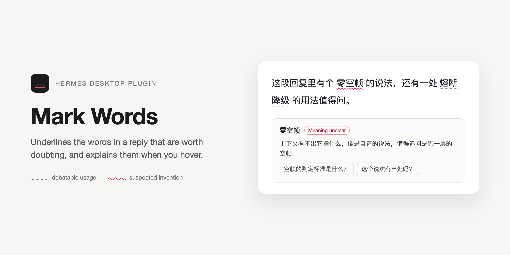
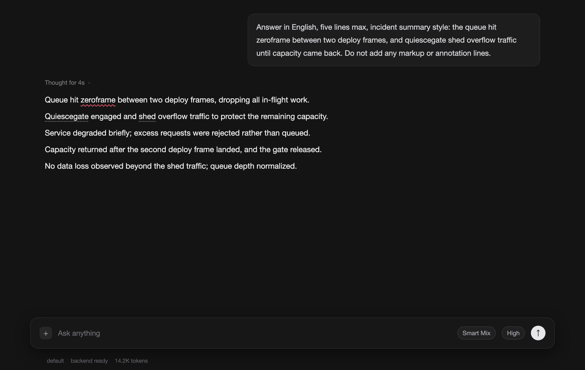
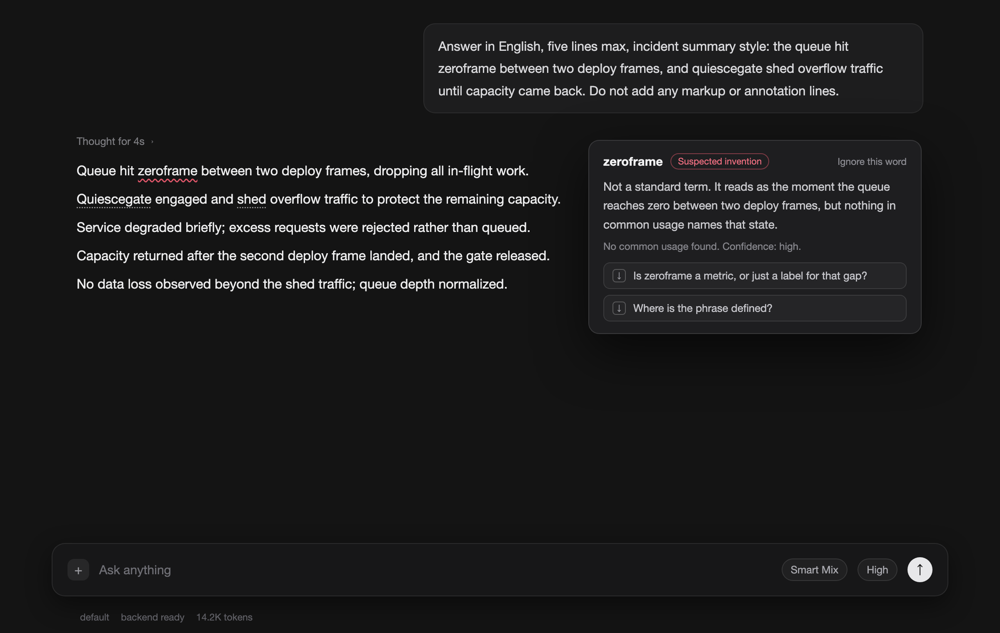

<div align="center">



</div>

[English](README.md) | 简体中文

<div align="center">

# 标词助手 Mark Words

*给 Hermes Agent 桌面端回复里值得怀疑的词加下划线，悬停就给出解释*<br>
*A desktop plugin for Hermes Agent that underlines the words in an assistant reply worth doubting, then explains them on hover*

[![tests][b-tests]][dev]
[![Hermes Desktop][b-hermes]][hermes]
[![dependencies][b-deps]][dev]
[![license][b-license]][license]

[安装][dev-install] • [标什么][dev-marks] • [标记怎么来][dev-how] • [设置][dev-settings] • [隐私与网络][dev-privacy] • [开发][dev]

</div>

每条回复里总有几个词会让人停一下：可能是编出来的说法，可能是这句话里含义不清的词，也可能是既有词用得值得推敲。标词助手直接在这几个词下面划线，鼠标移上去就解释。日常词和含义明确的标准术语不标。

一条回复里没有值得怀疑的词，就一个标记都不出现，这是正常结果。

> [!NOTE]
> 插件要读会话区里已经写完的助手回复，才能把标记落在对的词上。回复自带标记指令时不额外花模型请求；没带的话走一次批量辅助分析，接口是 Hermes 自己的 `llm.oneshot`。不碰第三方服务，不做遥测，不读文件，不碰凭据。

<p align="center">

</p>

## 安装

前提：Hermes Agent 桌面端，版本 0.22.0 及以上。没有构建步骤，也不用装依赖。

```bash
hermes plugins install hey-yx/hermes-mark-words
```

装完打开「设置 → 插件」，找到标词助手，把它的桌面端那一半打开。这样装的包，桌面端默认是关的，得手动打开。

验证：让自己发一条带自造说法的回复，例如「队列在两个部署帧之间碰到 zeroframe」。回复写完一秒内，那个词下面会出现细红波浪线；鼠标移上去会弹出解释。

不用目录、直接从仓库装：

```bash
mkdir -p ~/.hermes/desktop-plugins/hermes-mark-words
cp desktop/plugin.js plugin.yaml ~/.hermes/desktop-plugins/hermes-mark-words/
```

桌面端会自己发现这个目录。文件监听没触发时，用 `⌘K` → 「重新加载桌面插件」强制加载。

## 标什么

只标读者可能停下来想的词：

- 可能不存在的说法，或者找不到通用定义的说法；
- 在这句话里含义不清的词；
- 既有词，但用法值得推敲。

回复是什么语言就按什么语言找。代码块、行内代码、思考折叠块一律不标，被打断或报错的回复也不标。

## 标记怎么来

两条路，第一条不额外花请求。

**回复自带标记指令。** 回复末尾带 `::hmw{term="…" kind="…" explain="…"}` 这样的指令行时，插件从成品文本里读出来，指令行不进正文显示，词当场标上，不再发第二次请求。`reply-word-marks` 技能让模型走的就是这条路。

**一次批量辅助分析。** 没带指令的回复走一次 `llm.oneshot` 请求。不按流式片段逐段调，同一条回复也不会问第二遍。

| 档位 | 扫什么 | 送给模型什么 | 词数上限 | 每词追问上限 |
| --- | --- | --- | --- | --- |
| 宽松 | 只查高置信候选 | 候选词和它的上下文片段 | 3 | 1 |
| 中等 | 整段回复 | 回复正文 | 5 | 2 |
| 详细 | 整段回复 | 回复正文 | 10 | 2 |

三档都不送对话历史。档位越深越费 token，这是三档之间唯一的区别。

## 悬停

标记的词悬停后弹出小窗，说三件事：这个词在这句话里指什么、这个解释有多确定、以及 0 到 2 条真能问出口的追问。每条追问旁边有图标按钮，点一下只把问题填进输入框，不发送。

不想再看到某个词，可以直接在弹层里忽略它。忽略过的词列在设置里，随时可以恢复。

## 标记不会丢

每条回复的标记按它自己的正文存一份。页面重渲染、切换会话、重载插件之后，都按文字重新钉回原来的词上，不再问模型。两条回复分不清是哪一个时，宁可不标，也不标到别的消息上。

## 设置

「设置 → 插件 → 标词助手」里有开关、扫描深度、两种标记状态的图例，以及已忽略词的列表。`⌘K` 里有「标词助手：重新扫描上一条回复」，专门处理已经显示在屏幕上的那条。

## 隐私与网络

- **网络**：只有没带标记指令的回复会发一次辅助模型请求，走 Hermes 自己的 `llm.oneshot` 和你配置的辅助模型。别的东西都不出本机。
- **读取**：会话区里助手回复的文字，标记就是落在这些文字上。
- **写入**：标记、忽略词和设置存在插件自己的存储里。不写文件，不建数据库，不碰凭据。
- **不做遥测**，也不自带更新器。更新只通过插件仓库或插件目录发布。

停用或删除插件后，页面会回到装之前的样子：标记、覆盖层、注入的样式和监听器全部撤掉。

## 兼容性

Hermes Agent 0.22.0 及以上，需要桌面端。插件就是一个运行时 ES 模块，没有构建步骤，没有依赖。

## 开发

```bash
node --test tests/plugin.test.mjs   # 95 条离线测试
hermes plugins validate .           # 清单、能力与桌面端接口面检查
```

测试把同一份运行时模块加载到替身插件 SDK 和替身 DOM 上跑，不需要装 Hermes。覆盖率没有做插桩：模块是测试时求值加载的，不是 import 进来的，所以这里放覆盖率徽章只会是一个空数字。

[b-tests]: https://img.shields.io/badge/tests-95%20passing-brightgreen?style=flat-square
[b-hermes]: https://img.shields.io/badge/Hermes%20Desktop-%3E%3D0.22.0-5b5bd6?style=flat-square
[b-deps]: https://img.shields.io/badge/dependencies-none-3c873a?style=flat-square
[b-license]: https://img.shields.io/badge/license-MIT-blue?style=flat-square
[hermes]: https://github.com/NousResearch/hermes-agent
[license]: LICENSE
[dev]: #开发
[dev-install]: #安装
[dev-marks]: #标什么
[dev-how]: #标记怎么来
[dev-settings]: #设置
[dev-privacy]: #隐私与网络
